<p align="center">
  
</p>

# ⚡ Awesome-Event-Driven-Messaging-Platform

<p align="center">
  <a href="https://github.com/ishandutta2007/Awesome-Awesome-Awesome"></a><a href="https://discord.gg/jc4xtF58Ve"></a>
  <a href="https://github.com/ishandutta2007/Awesome-Event-Driven-Messaging-Platform/stargazers"></a>
  <a href="https://github.com/ishandutta2007/Awesome-Event-Driven-Messaging-Platform/network/members"></a>
  <a href="https://github.com/ishandutta2007/Awesome-Event-Driven-Messaging-Platform/pulls"></a>
  <a href="https://github.com/ishandutta2007/Awesome-Event-Driven-Messaging-Platform/blob/main/LICENSE"></a>
  <a href="https://github.com/ishandutta2007"></a>
</p>

---

## 🚀 Top Event-Driven Messaging Platform Ecosystem

**Curated Directory of Cloud SaaS Platforms & Open-Source Message Brokers**  
*Comprehensive Benchmark for Pub/Sub, Real-Time Event Streaming, Message Queuing & Distributed Event Meshes*  

📅 **Last updated: October 2026**

---

### 🌐 Overview & Architectural Context

This repository tracks the most impactful **SaaS managed services** and **open-source software projects** powering modern **Event-Driven Architectures (EDA)**. 

Event-driven messaging platforms allow systems to decouple producers from consumers, process high-velocity data streams in sub-millisecond real time, and scale microservices, IoT telemetry, distributed consensus, and agentic workflows without point-to-point synchronization bottlenecks.

```
+---------------+        +-------------------------------+        +---------------+
| Event Producer| -----> |  Event Broker / Streaming Bus | -----> | Event Consumer|
| (Microservice)|        |  (Topics / Queues / Streams)  |        | (Subscriber)  |
+---------------+        +-------------------------------+        +---------------+
                                |               |
                                v               v
                       +----------------+ +----------------+
                       | Dead-Letter Q  | | Event Mesh /   |
                       | & Replay Log   | | Consumer Groups|
                       +----------------+ +----------------+
```

---

## 📑 Table of Contents

- [📊 Sector Overview & Market Dynamics](#-sector-overview--market-dynamics)
- [☁️ SaaS/Hosted Platforms](#️-saashosted-platforms)
- [🐙 Open-Source GitHub Projects](#-open-source-github-projects)
- [🏗️ Architectural Frameworks & Patterns](#️-architectural-frameworks--patterns)
- [⭐ Star History](#-star-history)
- [💖 Support & Sponsoring](#-support--sponsoring)
- [🤝 How to Contribute](#-how-to-contribute)
- [⚖️ Disclaimer](#️-disclaimer)

---

## 📊 Sector Overview & Market Dynamics

- 📈 **Market Sizing & Accelerating Growth**: The global event-driven messaging, message broker, and event stream processing market is valued at approximately **$11.3B to $13.5B in 2026** and is projected to expand past **$30B+ by 2034**, compounding at an annual growth rate (**CAGR**) of **12% to 18%** (with the broader streaming analytics and real-time processing ecosystem surpassing $50B). Growth is heavily fueled by distributed microservices adoption, IoT telemetry volume, serverless architectures, and real-time AI/agentic inference pipelines.
- 🏢 **Market Structure & Fragmentation**: The sector demonstrates a **moderately fragmented, dual-tier structure**:
  - **Tier 1 (Hyperscaler Oligopoly)**: Cloud providers (**AWS, Microsoft Azure, Google Cloud**) along with enterprise SaaS titans (**Salesforce**) dominate high-volume managed queuing and pub/sub infrastructure tightly bound to their native compute ecosystems.
  - **Tier 2 (Specialized Open-Core Leaders)**: High-performance, open-standard independent vendors (**Confluent, Redpanda, Solace, StreamNative, Synadia**) command mission-critical, hybrid-cloud, and multi-region event mesh workloads—offering vendor neutrality, sub-millisecond latencies, and protocol flexibility that prevent a single winner-take-all monopoly.

---

## ☁️ SaaS/Hosted Platforms

The following SaaS and fully managed platforms are ranked in **descending order of company scale** (Market Capitalization / Valuation / Revenue).

| 🏢 Platform | 💰 Company Size (Valuation / Revenue) | 📝 Description & Key Features | 🏷️ Starting Pricing | 🎁 Free Tier / Trial Limits |
| :--- | :--- | :--- | :--- | :--- |
| **[Azure Service Bus](https://azure.microsoft.com/en-us/products/service-bus/)** | **~$3.1T Market Cap** *(~$245B+ Annual Revenue)* | Fully managed enterprise message broker with point-to-point queues and pub/sub topics with independent subscriptions, dead-lettering, sessions, and transactions. | Basic tier starts at **$0.05 per million operations** (queues only, $0 base fee); Standard tier starts at **~$10.00/month** base unit (~$0.0135/hr, includes 13M ops), then $0.05 per million operations. | **12-Month Free Trial** (via Azure Free Account): 750 hours/month of Standard tier base unit and 13 million operations/month for 12 months, plus $200 credit for the first 30 days. |
| **[Google Cloud Pub/Sub](https://cloud.google.com/pubsub)** | **~$2.1T Market Cap** *(~$350B+ Annual Revenue)* | Asynchronous messaging service decoupling producers and consumers. Features automatic horizontal autoscaling, schema enforcement, and fan-in / fan-out topologies. | Standard throughput starts at **$40.00 per TiB** ($0.04/GiB) after free tier; Pub/Sub Lite starts at **$0.005/MiBps** partition-hour + $0.04/GiB-month storage. | **Permanent Always Free Tier**: 10 GiB of message throughput/month and first 24 hours of message storage free; new GCP accounts receive a 90-day $300 trial credit. |
| **[AWS SNS](https://aws.amazon.com/sns/)** | **~$2.0T Market Cap** *(~$600B+ Annual Revenue)* | Fully managed pub/sub messaging for A2A and A2P communication. Supports standard and FIFO topics, subscription filtering, and message fan-out to SQS, Lambda, HTTP/S, and mobile push. | **$0.50 per 1 million requests** (Standard topics; FIFO topics at $0.30/1M requests + $0.09/GB payload); HTTP/S delivery at $0.60 per 1M notifications. | **Permanent Free Tier**: 1,000,000 API requests/month, 100,000 HTTP/S notifications/month, 1,000 email notifications/month, and 1,000,000 mobile push notifications/month (deliveries to SQS and Lambda are free). |
| **[Salesforce Platform Events](https://developer.salesforce.com/docs/platform/platform-events/guide/platform-events-intro-emp.html)** | **~$270B Market Cap** *(~$38B Annual Revenue)* | Enterprise messaging platform based on pub/sub model. Publishers and subscribers communicate asynchronously via events. High-volume platform events publish with at-least-once delivery; Event Relay delivers events to Amazon EventBridge. | Enterprise Edition starts at **$165/user/month** (includes base platform events); High-Volume Platform Events Add-On starts at **$500/month** (+100,000 events/day). | **Permanent Free Developer Edition**: 10,000 delivered events/24 hrs, 20 concurrent CometD subscribers, and 5 custom event definitions; 30-day free trial orgs available. |
| **[Confluent Cloud](https://www.confluent.io/confluent-cloud/)** | **~$11B Enterprise Value** *(~$1.17B Annual Revenue)* | Fully managed Apache Kafka service built on Kora engine. Features elastic clusters, 120+ pre-built connectors, Stream Governance, and managed Apache Flink. | Basic tier starts at **$0/month base fee** with usage at ~$0.11/GB data ingress, ~$0.11/GB egress, and $0.10/GB-month storage; Standard tier starts at ~$1.50/hour base. | **30-Day Free Trial**: $400 in free credits (no credit card required upfront) valid across Basic, Standard, Enterprise, and Freight clusters. |
| **[Redpanda Cloud](https://www.redpanda.com/redpanda-cloud)** | **~$1.0B Valuation** *(Series D Unicorn)* | Fully managed streaming data platform with Kafka API compatibility. Built in C++ without JVM or ZooKeeper for ultra-low latency and 3x hardware efficiency. | Serverless tier starts at **$0 base fee/hour** with usage at ~$0.02–$0.045/GB ingress, ~$0.02–$0.04/GB egress, and ~$0.09/GB-month storage; Dedicated clusters start at ~$0.20/hour per broker. | **30-Day Free Trial**: $100 in free credits (no credit card required), capped at 100 MB/s ingress, 300 MB/s egress, 5,000 partitions, and 10,000 connections. |
| **[Solace PubSub+ Cloud](https://solace.com/cloud-dev-pubsub/)** | **~$500M+ Valuation** *(~$100M+ ARR)* | Enterprise-grade event broker as a service supporting pub/sub, queuing, streaming, and dynamic event meshes over open protocols (AMQP, MQTT, JMS, REST, WebSocket). | Foundation platform package with consumption drawdown via Platform Capacity Units (PCUs); broker instances scale per PCU-hour (enterprise starting packages via marketplace/sales). | **30-Day Free Trial**: Enterprise-100 Standalone broker with 100 concurrent connections, 100 queues/endpoints, 25 GB message spool storage, and 500,000 subscriptions; permanent Developer Service Tier ($0) capped at 100 connections. |
| **[NATS Cloud (Synadia Cloud)](https://synadia.com/cloud)** | **~$150M–$200M Valuation** *($51M Total Funding)* | Managed NATS platform offering core pub/sub, JetStream persistent streaming, Key/Value store, Object Store, and multi-region leaf nodes. | Starter plan starts at **$49/month** (includes 100 connections, 100 GiB network data, 10 GiB storage, 3 accounts, and 3 leaf nodes). | **Permanent Free Tier** (Personal Plan): 10 concurrent connections, 10 GiB network data/month, 5 GiB standard storage, 10 standard streams, 2 accounts, and 2 leaf nodes. |
| **[Apache Pulsar Cloud (StreamNative)](https://streamnative.io/)** | **~$100M–$150M Valuation** *(~$14M ARR, $30M Funding)* | Cloud-native distributed messaging and streaming powered by Apache Pulsar. Features layered compute/storage separation, multi-tenancy, and geo-replication. | Serverless tier starts at **~$0.50 per ETU** (Elastic Throughput Unit) per hour + $0.10/GB-month storage. | **30-Day Free Trial**: $200 in free credits (no credit card required) for Serverless cluster evaluation. |
| **[RabbitMQ Cloud (CloudAMQP)](https://www.cloudamqp.com/)** | **~$80M–$100M Valuation** *(~$15M–$20M ARR, Bootstrapped)* | Managed RabbitMQ service supporting AMQP 0-9-1, AMQP 1.0, MQTT, and STOMP with flexible routing, message clustering, and management console. | Shared plans start at **$19/month** (Tough Tiger); dedicated single-node instances start at **$99/month** (Big Bunny). | **Permanent Free Tier** (Little Lemur plan): 1,000,000 messages/month, 20 concurrent connections, 100 queues, and up to 10,000 queued messages (inactive instances deleted after 2 months). |

---

## 🐙 Open-Source GitHub Projects

All open-source message brokers, streaming engines, and event-driven frameworks are listed below, **sorted in descending order by GitHub_Stars**.  
Each Stars_Badge links directly to that repository's stargazers page.

1. **[Redis Streams](https://github.com/redis/redis)** [](https://github.com/redis/redis/stargazers)  
   In-memory data structure store (BSD-3-Clause / RSALv2) used globally as a high-speed distributed message broker, streaming engine with consumer groups, and pub/sub bus with sub-millisecond latencies.

2. **[Apache Kafka](https://github.com/apache/kafka)** [](https://github.com/apache/kafka/stargazers)  
   The industry-standard distributed event streaming platform (Apache-2.0) capable of handling trillions of events daily with fault-tolerant storage, stream processing, consumer groups, and massive connector ecosystem.

3. **[Celery](https://github.com/celery/celery)** [](https://github.com/celery/celery/stargazers)  
   Simple, flexible, and reliable distributed task queue and asynchronous event-driven message passing framework in Python (BSD-3-Clause) supporting RabbitMQ, Redis, and Amazon SQS brokers.

4. **[Dapr](https://github.com/dapr/dapr)** [](https://github.com/dapr/dapr/stargazers)  
   Distributed Application Runtime (Apache-2.0) offering portable, event-driven building blocks including pluggable Pub/Sub providers, state management, and CloudEvents bindings across any cloud and edge.

5. **[Apache RocketMQ](https://github.com/apache/rocketmq)** [](https://github.com/apache/rocketmq/stargazers)  
   Cloud-native distributed messaging and streaming data platform (Apache-2.0) with low latency, high concurrency, ordered messaging, and transactional event handling battle-tested at Alibaba scale.

6. **[NATS Server](https://github.com/nats-io/nats-server)** [](https://github.com/nats-io/nats-server/stargazers)  
   Cloud-native messaging system (Apache-2.0) engineered in Go for extreme simplicity, sub-millisecond latencies, multi-tenancy, and persistent streaming via JetStream. Single lightweight binary (~15MB memory footprint).

7. **[EMQX](https://github.com/emqx/emqx)** [](https://github.com/emqx/emqx/stargazers)  
   Ultra-scalable open-source distributed MQTT broker (Apache-2.0) designed for massive IoT telemetry, connected vehicles, and industrial real-time event streaming scaling to 100M+ concurrent connections.

8. **[Apache Pulsar](https://github.com/apache/pulsar)** [](https://github.com/apache/pulsar/stargazers)  
   Distributed pub/sub messaging and streaming platform (Apache-2.0) with low latency (<10ms), multi-tenancy, geo-replication, tiered storage, and separated compute/storage architecture via Apache BookKeeper.

9. **[RabbitMQ Server](https://github.com/rabbitmq/rabbitmq-server)** [](https://github.com/rabbitmq/rabbitmq-server/stargazers)  
   The quintessential open-source multi-protocol message broker (MPL-2.0) written in Erlang supporting AMQP 0-9-1, AMQP 1.0, MQTT, STOMP, Quorum queues, and flexible routing topologies.

10. **[Asynq](https://github.com/hibiken/asynq)** [](https://github.com/hibiken/asynq/stargazers)  
    Simple, reliable, and efficient distributed task queue and asynchronous event processing library in Go (MIT) backed by Redis with priority queues, retries, and rate limiting.

11. **[Redpanda](https://github.com/redpanda-data/redpanda)** [](https://github.com/redpanda-data/redpanda/stargazers)  
    Apache Kafka-compatible event streaming platform (BSL/Apache-2.0) engineered in C++ with Raft consensus, eliminating ZooKeeper and JVM overhead for 10x lower tail latencies and simplified operations.

12. **[Eclipse Mosquitto](https://github.com/eclipse-mosquitto/mosquitto)** [](https://github.com/eclipse-mosquitto/mosquitto/stargazers)  
    Lightweight open-source message broker (EPL-2.0/EDL-1.0) implementing MQTT versions 5.0, 3.1.1, and 3.1 for constrained devices, smart home automation, and edge gateways.

13. **[ZeroMQ (libzmq)](https://github.com/zeromq/libzmq)** [](https://github.com/zeromq/libzmq/stargazers)  
    High-performance asynchronous messaging library (MPL-2.0) providing smart sockets that carry atomic messages across in-process, IPC, TCP, and PGM multicast without dedicated broker daemons.

14. **[Centrifugo](https://github.com/centrifugal/centrifugo)** [](https://github.com/centrifugal/centrifugo/stargazers)  
    Scalable real-time messaging server (Apache-2.0) over WebSocket, HTTP-streaming, SSE, and WebTransport with channel multiplexing, JWT authentication, and Redis/NATS backends.

15. **[Watermill](https://github.com/ThreeDotsLabs/watermill)** [](https://github.com/ThreeDotsLabs/watermill/stargazers)  
    Efficient Go library (MIT) for building event-driven applications, supporting Kafka, RabbitMQ, Google Cloud Pub/Sub, NATS, AWS SQS/SNS, and SQL transactional outbox patterns.

16. **[MQTT.js](https://github.com/mqttjs/MQTT.js)** [](https://github.com/mqttjs/MQTT.js/stargazers)  
    Universal MQTT client library for JavaScript, Node.js, and browser environments (MIT) supporting WebSocket and TCP connections with broad IoT and mobile support.

17. **[Soketi](https://github.com/soketi/soketi)** [](https://github.com/soketi/soketi/stargazers)  
    Fast, resilient, Pusher-compatible open-source WebSocket server (MIT) built on uWebSockets.js for event fan-out with Redis horizontal clustering and SSL support.

18. **[Memphis.dev](https://github.com/memphisdev/memphis)** [](https://github.com/memphisdev/memphis/stargazers)  
    Developer-first message broker and streaming data platform (GPL-3.0 / Apache-2.0) built for modern cloud and Kubernetes stacks with built-in schema management and real-time observability.

19. **[Apache EventMesh](https://github.com/apache/eventmesh)** [](https://github.com/apache/eventmesh/stargazers)  
    Dynamic cloud-native event middleware (Apache-2.0) based on CloudEvents specifications providing seamless multi-protocol and multi-runtime event mesh routing across RocketMQ, Kafka, Pulsar, and Redis.

20. **[Knative Eventing](https://github.com/knative/eventing)** [](https://github.com/knative/eventing/stargazers)  
    Kubernetes-native event-driven architecture framework (Apache-2.0) providing declarative routing, filtering, channels, and brokers conforming to the CNCF CloudEvents standard.

21. **[Outpost (Hookdeck)](https://github.com/hookdeck/outpost)** [](https://github.com/hookdeck/outpost/stargazers)  
    Self-hostable outbound webhooks infrastructure (Apache-2.0) pushing events to customer endpoints, SQS, RabbitMQ, or Kinesis with retries, signature verification, and OpenTelemetry instrumentation.

22. **[Ripple](https://github.com/madisoheib/Ripple)** [](https://github.com/madisoheib/Ripple/stargazers)  
    Self-hosted, lightweight Pusher-compatible WebSocket server written in Rust with low memory footprint and sustained 50k deliveries/s at p50 14.7ms latency.

23. **[Event (rbaliyan)](https://github.com/rbaliyan/event)** [](https://github.com/rbaliyan/event/stargazers)  
    Go event bus library with transactional outbox pattern, idempotency middleware, poison message quarantine, and dead-letter queues supporting Redis Streams and NATS.

---

## 🏗️ Architectural Frameworks & Patterns

When designing enterprise-grade custom event-driven architectures:
- **Messaging Core**: Select **Apache Kafka**, **Redpanda**, **Apache Pulsar**, or **NATS JetStream** based on retention needs, latency targets, and operational overhead.
- **Protocol Interconnect**: Integrate **Apache EventMesh** or **Dapr** for cross-protocol bridging (AMQP, MQTT, HTTP, gRPC) and CloudEvents compliance.
- **Client Real-Time Delivery**: Deploy **Centrifugo**, **Soketi**, or **Ripple** for high-concurrency WebSocket and SSE push to web/mobile clients.
- **Outbound Webhooks**: Leverage **Outpost (Hookdeck)** to deliver customer webhooks with retries, signature verification, and delivery tracking.
- **Transactional Consistency**: Use **Watermill** or **Event (rbaliyan)** for outbox pattern implementation, deduplication, and consumer idempotency.

---

## ⭐ Star History

[](https://star-history.dera.page/#ishandutta2007/Awesome-Event-Driven-Messaging-Platform&type=date&legend=top-left)

---

## 💖 Support & Sponsoring

A sincere thank you to every platform engineer, architect, and open-source contributor advancing event-driven architectures and real-time streaming worldwide!

If this curated repository saved you time, informed your architecture decisions, or assisted in your platform evaluation:
- ⭐ **Star this repository** on GitHub to help other engineers discover it!
- 🍴 **Fork it** to add newly emerged message brokers, cloud tiers, or architectural benchmarks.
- 📢 **Share it** with your team on Slack, Discord, Reddit, or LinkedIn.
- ☕ **Sponsor & Buy a Coffee**: Support continuous research, benchmarking updates, and repository maintenance through the [GitHub Sponsor Dashboard](https://github.com/sponsors/ishandutta2007).

---

## 🤝 How to Contribute

We actively welcome community contributions! To suggest new tools or update existing entries:

1. **Fork the repository** on GitHub.
2. **Add or edit entries in [README.md](file:///C:/Users/ishan/Documents/Projects/Awesome-Event-Driven-Messaging-Platform/README.md)** (adhering to the table structure for SaaS platforms and descending Stars_Count for open-source repos).
3. Ensure entries include: platform name, official URL, concise description, specific pricing/limits or Stars_Badges.
4. **Submit a Pull Request** with a brief summary of the addition or update.

---

## ⚖️ Disclaimer

- This is a community-curated technical directory for informational purposes and does not represent an endorsement or financial advice.
- Event-driven platforms processing sensitive business events must adhere to compliance regulations (GDPR, HIPAA, SOC 2, CCPA).
- Self-hosted open-source brokers require production hardening, TLS mutual authentication, clustering safeguards, and proper message idempotency handling.

---

<p align="center">
  <b>Built with ⚡ for Platform Engineers, Systems Architects, and Distributed Systems Developers.</b><br>
  Explore more curated lists on <a href="https://github.com/ishandutta2007/Awesome-Awesome-Awesome">Awesome-Awesome-Awesome</a>.
</p>
